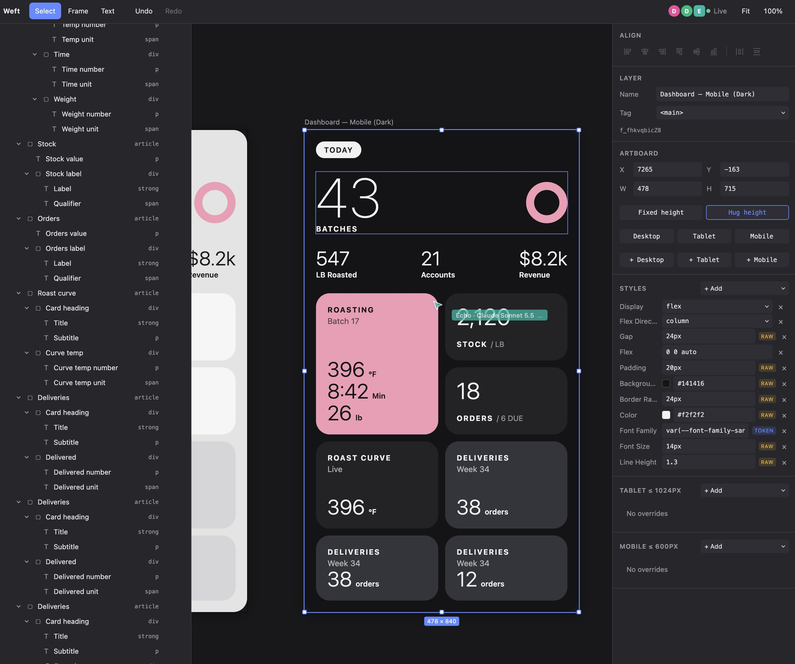

# Weft

An AI-native design canvas where the canvas *is* the browser's DOM and CSS engine. Edit pages the way you would in any WYSIWYG editor, but every artboard is real HTML and CSS, so what you design is what you ship. People and AI agents edit the same live document.

> Status: early, local-only. M1–M3 done: canvas, AI bridge, and single-user editing (multi-select, responsive breakpoints, layers panel, align/distribute, snapping, artboard cloning and Hug/Fixed height). See [Roadmap](#roadmap).

## Quick start

Requires Node and [pnpm](https://pnpm.io).

```sh
pnpm install
pnpm dev
```

Open http://localhost:5173. This starts both the editor and the local server (`127.0.0.1:4510`).

URL parameters:

| Param | Effect |
|---|---|
| `?doc=name` | Open a named document (default: `default`) |
| `?offline` | Browser-only document stored in IndexedDB, no server |
| `?ephemeral` | Fresh in-memory seed (used by tests) |

**Files:** **Save** in the toolbar downloads the document as `<doc>.weft` (the same JSON the server keeps in `.weft-data/`). **Open…** adds the artboards from a `.weft` or `.weft.json` file to the current document, beside the existing ones, with their fonts, as one undo step; malformed files are rejected without changing anything. **Export HTML** (Inspector, with an artboard selected) downloads that artboard as a standalone page with its breakpoints as `@media` rules. Exported pages link Google Fonts, so fonts need a network until font bundling lands.



## Connect an AI agent (MCP)

The server speaks MCP over Streamable HTTP at `http://127.0.0.1:4510/mcp`. With the server running:

```sh
claude mcp add --transport http weft http://127.0.0.1:4510/mcp
```

The repo's `.mcp.json` already registers it for Claude Code. Agents are told to read the design skill (`read_skill`, files in `apps/server/skill/`) before designing, and to check each section with `get_screenshot`. Screenshots use the Chromium that Playwright installs (`pnpm --filter @weft/web exec playwright install chromium`); rendering runs with JavaScript off and all network requests blocked. Each MCP connection is its own agent with a callsign, colored cursor and undo history, and its edits highlight live in the editor.

| Tool | What it does |
|---|---|
| `get_canvas` | Scene graph as nested JSON (all artboards or one subtree); `detail: "outline"` returns only ids, names and text, about 8× smaller |
| `get_selection` | What each person has selected |
| `list_tokens` | Design tokens and the CSS value to use, including the document's font tokens |
| `search_fonts` | Search the bundled Google Fonts catalog (offline), by name or category |
| `add_fonts` / `remove_fonts` | Add Google Fonts to the document (each becomes `var(--font-family-<slug>)`) or remove them |
| `get_layout` | Real rendered boxes and computed styles (needs an editor open) |
| `get_screenshot` | PNG of an artboard or node plus its child boxes, rendered in headless Chromium with no editor open; `width` renders at another width (e.g. 390 for mobile) |
| `read_skill` | Weft's design skill for agents: layout recipes, style and taste rules, how to check work. No path returns the whole guide; a path returns one file (also served as `weft://skill/*` resources) |
| `create_nodes` | Create node subtrees or new artboards, atomically (with optional `breakpoints` overrides) |
| `update_nodes` | Patch names, text, styles, breakpoint overrides, attributes, frames |
| `move_node` | Reparent or reorder |
| `duplicate_node` | Deep-copy a node; clone an artboard at another width (`frame: {width: 390}`) beside the original. Returns `ids`, mapping every original node to its copy |
| `align_nodes` | Align left/center/right/top/middle/bottom: artboards by frame, elements via flex/grid CSS (`justifyContent`, `alignSelf`, `justifySelf`) |
| `distribute_nodes` | Even spacing: artboard gaps, or `justifyContent: space-between` on a flex parent |
| `delete_nodes` | Delete nodes and descendants |
| `undo_agent_change` | Revert that agent's last call |
| `select_nodes` | Select and zoom to nodes in every open editor |
| `export_html` | An artboard as a standalone HTML page (the page `get_screenshot` renders) |
| `import_file` | Add the artboards (and fonts) from a saved `.weft` document's JSON, beside the existing ones, in one undoable step |

### Remote agents (e.g. Muse, GrokBot)

Agents running in the cloud can't reach `127.0.0.1`. To let one in, put the server behind a tunnel and give that agent its own token:

1. Run a tunnel to the server: `ngrok http 4510`, or `ngrok http --url=<your-static-domain> 4510` so the URL stays the same. Don't use `--host-header=rewrite`.
2. In the editor, open **Remote** (toolbar, top right), switch on **Allow remote agents**, and add the agent by name. Copy its token: it's shown once and stored only as a hash in `.weft-data/remote.json`.
3. Give the agent the public URL shown in the panel (`https://<domain>/mcp`) and its token, sent as `Authorization: Bearer <token>` (or `?key=<token>` for agents that only take a URL).

The agent appears on the canvas under its name with its own cursor and undo. Remote requests reach `/mcp` only; sync, editor RPC, Assist and the Remote settings (`GET /remote`, `POST /remote/enabled|agents|revoke`) stay local, and any request forwarded by a tunnel or proxy counts as remote whatever its Host header says. Remote access is off by default and stays as you leave it across restarts; switching it off or revoking a token disconnects those agents immediately. With the tunnel stopped nothing outside this machine can reach the server. Every token can read and edit every document on this server (no per-document scoping or rate limits yet).

## Edit with a local model (Assist)

The prompt bar at the bottom of the canvas edits the document with a model running on your machine through [Ollama](https://ollama.com), fully offline. Select something, describe the change ("stack these cards in one column"), and the model edits it live through the same tools MCP agents use, with its own cursor. **Undo** in the bar reverts the model's whole last turn (⌘Z only undoes your own edits); **New** starts a fresh conversation.

- Run Ollama and pull a model with tool calling, e.g. `ollama pull qwen3.5:4b` (fast) or a 12–30B model (more reliable on multi-step edits). The picker lists local tool-capable models, largest first, and remembers your choice; cloud models are left out.
- The server talks to Ollama at `OLLAMA_HOST` (default `127.0.0.1:11434`).
- Needs the server: not available with `?offline` or `?ephemeral`.
- Server routes (loopback, local origins only): `GET /assist/models`, `POST /assist/chat` (NDJSON progress stream), `POST /assist/undo`, `POST /assist/reset`.

## Project layout

```
packages/core   Framework-free scene graph: schema, GridDocument commands, history, W3C tokens
apps/web        Vite + React editor: canvas (shadow-DOM artboards), overlay, panels
apps/server     Local Node process: Yjs sync + presence, browser RPC, MCP, local-model assist, persistence
evals           Prompts and a results log for testing how well agents build in Weft
```

Documents persist to `.weft-data/` (`<name>.ydoc` plus a readable `<name>.weft.json`). Contributor and agent rules live in [CLAUDE.md](./CLAUDE.md).

## Scripts

| Command | Purpose |
|---|---|
| `pnpm dev` | Server and editor |
| `pnpm test` | Unit tests (core and server, vitest) |
| `pnpm test:e2e` | Playwright against the editor (screenshots in `apps/web/test-results/`) |
| `pnpm typecheck` | Typecheck every package |

## Roadmap

- [x] **M1 — Canvas foundation:** scene graph, shadow-DOM artboards, editing tools
- [x] **M2 — AI bridge:** MCP server, live sync, agent presence and cursors
- [x] **M3 — Single-user editing**
  - [x] Multi-select: marquee, shift-click, ⌘A, group move
  - [x] Responsive breakpoints: per-node tablet (≤ 1024px) and mobile (≤ 600px) overrides, previewed by artboard width, with Desktop/Tablet/Mobile width presets
  - [x] Clone an artboard at mobile/tablet width to compare layouts side by side (Inspector "+ Mobile"/"+ Tablet"); ⌘D duplicates the selection
  - [x] Layers panel: double-click rename, hide/lock toggles (locked layers are click-through on the canvas), collapse/expand, drag to reorder and reparent, shift-click range and ⌘-click toggle
  - [x] Align and distribute: artboards by frame; elements in flex/grid parents get CSS alignment, not coordinates (Inspector buttons, ⌥A/H/D/W/V/S, ⌥⇧H/V)
  - [x] Artboard height: Hug (fits content, follows width changes live; default for new artboards and clones at another width) or Fixed (clips overflow, marked with a dashed red edge)
  - [x] Snapping and smart guides: artboard move and resize snap edges and centers to other artboards (hold ⌘/Ctrl to move freely)
  - [x] Assist: prompt bar that edits with a local Ollama model through the MCP tools (own cursor, whole-turn undo, offline)
  - [x] Drag elements on the canvas to reorder or reparent them, following the parent's flex/grid flow, with an insertion line (Esc cancels)
  - [x] Copy, cut and paste layers (⌘C/⌘X/⌘V or the browser's Edit menu), between documents too; plain text pastes as a paragraph
- [x] Remote agents over MCP through a tunnel, with per-agent tokens and an on/off switch in the editor
- [ ] **M4 — Agent design quality** (in order)
  - [x] Weft design skill served over MCP (a `read_skill` tool or MCP resources, like pen.dev's), so remote agents get it without installing anything: the scene model and allowed properties, patterns (headings with spans, grids over nested wrappers), a build-then-verify loop, and taste rules against generic AI layouts. Later: style archetypes that set tokens (fonts, colors, spacing)
  - [x] Render tool: a screenshot of an artboard or node (plus boxes), so agents can compare their result with a reference image, also with no editor open
  - [ ] Image support: content-addressed assets in `.weft-data/assets/`, an upload route behind the same agent tokens (files never go through the model), an image node with required alt text, drag/drop and paste; raster formats first, sanitized SVG later
  - [ ] Design lint: run checks like [Impeccable](https://impeccable.style/)'s detector against rendered artboards (real HTML/CSS) and report issues to agents and in the editor
- [ ] Components and variants
- [ ] Multiplayer beyond local; hosted server (per-token document scoping, rate limits)
- [ ] Code export
  - [x] Export an artboard as a standalone HTML page (Inspector button, `export_html` tool), with the artboard reset and `@media` breakpoints
  - [x] Save and open documents as `.weft` files
  - [ ] Bundle font files into export (a zip) so exported pages work offline; class-based CSS instead of inline styles
- [x] Google Fonts: searchable typeface picker from a bundled catalog (no API key); a document-level font list (synced, undoable, MCP tool) that generates `--font-family-*` tokens; the editor loads fonts with one `<link>` in the main page, since fonts declared inside shadow roots are ignored; export ships the same `<link>`. Font files are cached in `.weft-data/fonts/` after first use, so documents work offline. Later: italics, and bundling font files into export
- [ ] In-app local model assist (to consider): a local model built into the editor, separate from MCP agents, for inline suggestions. First idea: on a breakpoint section's "+ Add", suggest mobile/tablet overrides for the selected section (e.g. stack a grid to one column, shrink gap and padding) that the user previews and accepts
- [ ] Desktop shell (Electron)

## Changelog

- **2026-10-22:** Files and HTML export. **Save** downloads the document as `<doc>.weft`; **Open…** adds a `.weft`/`.weft.json` file's artboards and fonts beside the existing ones as one undo step (core `readWeftFile` + `GridDocument.importFile`, validated like paste, so bad files change nothing; unknown fonts are dropped). **Export HTML** in the Inspector downloads an artboard as a standalone page. New MCP tools `export_html` and `import_file`; `window.weft.agent.importFile`. Unlike paste, files carry the document's fonts.
- **2026-10-21:** Taste rules in the design skill, adapted in part from [taste-skill](https://github.com/Leonxlnx/taste-skill) (MIT). `style.md` adds: start from an idea; color roles and proportion; a type scale with few sizes far apart, display tracking and a two-line headline limit; composition (shared edges, varied sections); a table of generic tells (violet gradients, cream and terracotta, eyebrow labels, bento tiles, pill badges, …) with what to do instead; copy rules; aria for shape-built charts and the active tab; and monospace labels and middle-dot meta strings as tells. New style property `fontVariantNumeric` (Inspector: Type), so numbers can line up with `tabular-nums` without a monospace font. From the first reference evals (Opus and Grok, CarGurus home): `listStyle` is allowed; `get_canvas` outlines include artboard `x`/`y`; the style-guide reminder is kept per agent, so sessionless clients (which get a fresh server per request) stop seeing it once they've read the guide; and the skill keeps reference and user copy verbatim and asks for a menu button when mobile hides the nav. These are defaults (strong opinions, loosely held): an explicit design system, brand, reference or request from the user overrides any of them. `read_skill` with no path now returns the whole guide in one text (about 20 KB), since agents read the overview and skipped the files it pointed to; and `create_nodes` adds a `note` asking an agent to read it when its session hasn't read the style guide (not for Assist, which has no `read_skill`). `verify.md` asks agents to fix what breaks at the other width rather than list it, and adds a critique to run when a design is built (one second, squint, cover the name, edges, sameness, tells) and the order to fix things in. Prompted by the Grok Bloom Health run (`evals/results/2026-10-20-bloom-health-grok.md`).
- **2026-10-20:** Google Fonts. A bundled catalog of 1,738 families (`packages/core/src/font-catalog.ts`, regenerated by `packages/core/scripts/build-font-catalog.mjs`, no API key) backs a searchable picker: the **Aa** button on a Font Family style, and a Fonts list in the Inspector when nothing is selected. Documents keep a synced, undoable font list (`GridDocument.addFonts`/`removeFonts`); each font becomes a `--font-family-<slug>` token with a fallback stack. The server serves fonts from a local cache (`/fonts.css`, `/fonts/files/*`, stored in `.weft-data/fonts/`), fetching each stylesheet and file from Google once, so documents keep their fonts offline; without the cache or a network, text falls back to the stack. Screenshots load fonts from the same cache. New MCP tools `search_fonts`, `add_fonts`, `remove_fonts`; `list_tokens` takes `doc` and includes font tokens. Export links Google Fonts.
- **2026-10-20:** Fixes from the first Opus eval. `duplicate_node` returns `ids` (every original node id → its copy), so agents edit copies without re-reading them. `get_canvas` takes `detail: "outline"` (ids, tags, names, short text; unindented): 68 KB → 8.6 KB on a real mobile screen. New tags: `dl`/`dt`/`dd` and `table`/`caption`/`thead`/`tbody`/`tfoot`/`tr`/`th`/`td`. The skill's overview now lists the five most important rules, insists on reading the layout and style guides before building, and asks for a check at the other end of the width range.
- **2026-10-20:** `evals/`: agent evals for building in Weft. First eval: build-from-reference (rebuild a page from an image, check mobile, and report tool calls, rejections and token usage), with a results template, scoring rubric and log.
- **2026-10-20:** Design skill and screenshots for agents. `read_skill` (and `weft://skill/*` MCP resources) serves Weft's design skill from `apps/server/skill/`: the model, workflow, layout recipes, style rules and a verification checklist, with the allowed tags, style properties and breakpoints filled in from the schema. `get_screenshot` renders an artboard or node in headless Chromium (no editor needed; JavaScript off, network blocked) and returns a PNG plus child boxes; `width` previews breakpoints. Core gains `exportArtboardHTML`, standalone HTML for an artboard and the start of code export. Assist's local models don't get these two tools.
- **2026-10-20:** Roadmap: M4 — Agent design quality (a Weft design skill over MCP, a render tool, image support, design lint), ranked ahead of components, export and fonts.
- **2026-10-20:** Easier agent authoring. More style properties: longhand margins and padding (`marginTop`, `paddingLeft`, …), `border` and per-side borders, `position`/`top`/`left`/`inset`/`zIndex`, `flexGrow`/`flexShrink`/`flexBasis`/`order`, `textDecoration`, `fontStyle`, `whiteSpace`, `textOverflow`, `transform`, `objectFit`/`objectPosition`, `cursor`, and `backgroundImage` for gradients (`url()`, `image-set()` and CSS escapes are rejected in every style). `p`, `h1`–`h6`, `span`, `blockquote` and `figcaption` can be frames, so a heading can hold differently styled spans. Rejected `create_nodes`/`update_nodes` calls list every problem at once with its path (`nodes[0].children[2]`) and a hint ("use marginTop", "did you mean color?"), plus the allowed property list, instead of only the first error.
- **2026-10-20:** Copy, cut and paste layers. ⌘C/⌘X/⌘V and the browser's Edit menu copy the selected layers with their subtrees; paste goes into the selected container, or right after the selected layer (or after the copied layer itself), and artboards land beside their row. One undo step; works across documents in the same browser. Plain text from other apps pastes as a paragraph. Pasted content is validated in core like any create (`GridDocument.copyNodes`, `insertTrees`, `readClipboard`) and a bad paste changes nothing. Text fields and text editing keep native copy/paste.
- **2026-10-20:** Remote agents. A **Remote** panel in the toolbar lets agents outside this machine (e.g. Muse or GrokBot through an ngrok tunnel) use the MCP tools: off by default, one revocable token per agent (hashed in `.weft-data/remote.json`), shown on the canvas under the agent's name. Remote requests reach `/mcp` only and never from a web page; requests relayed by a tunnel or proxy are never treated as local, even with a rewritten Host header. The panel shows the running ngrok tunnel's URL.
- **2026-10-19:** Assist: a prompt bar at the bottom of the canvas edits the document with a local Ollama model, fully offline. The server runs the tool loop (`/assist/*` routes) against the same MCP tools outside agents use, in process, so the model gets its own cursor, atomic edits and an Undo that reverts its whole turn. It sees the current selection, `doc`/`model` arguments are filled in for it, and tool errors go back to the model to fix. `OLLAMA_HOST` picks the Ollama server.
- **2026-10-19:** Canvas drag and drop for elements. Dragging an element (or a multi-selection) reorders it among its siblings along the parent's flex/grid axis, or reparents it into another container; a dashed outline marks the receiving parent and a line marks the slot. Inside its own parent, siblings take precedence and only the middle half of a sibling container drops into it. One undo step; Esc cancels. Artboards still move by frame.
- **2026-10-18:** M3 complete. Dropped per-breakpoint text, visibility and tag from the roadmap: breakpoint overrides stay styles-only (hide per breakpoint with a `display: none` override).
- **2026-10-18:** Artboard Hug/Fixed height. `frame.heightMode: 'hug'` sizes an artboard to its content, so narrowing it grows it live; dragging a top/bottom handle or setting a height makes it fixed, and fixed artboards mark clipped content. New artboards, the seeded page and clones at another width hug by default. Inspector Fixed/Hug toggle; `create_nodes`/`update_nodes`/`duplicate_node` accept `heightMode` (new MCP artboards hug unless given a height).
- **2026-10-18:** Roadmap: Google Fonts typeface picker (self-hosted fonts later, for offline use) and in-app local model assist (suggested breakpoint overrides), separate from MCP agents. Layers panel is resizable by dragging its right edge (240–340px, remembered per browser). Fix: `create_nodes`/`update_nodes` accept a single breakpoint (e.g. only `mobile`); Zod 4 records with enum keys were requiring every breakpoint, pushing agents to pass `tablet: null`, which clears tablet overrides.
- **2026-10-17:** Duplicate and clone at width. `GridDocument.duplicateNode` deep-copies a subtree; artboard copies land to the right of their row. The Inspector's Artboard section clones at Desktop/Tablet/Mobile width beside the original (named "— Mobile" etc.) so breakpoint layouts compare side by side. ⌘D duplicates the selection. New MCP tool `duplicate_node` and `window.weft.agent.duplicateNode`.
- **2026-10-17:** Snapping and smart guides. Dragging artboards snaps the selection's edges and centers to other visible artboards within 6 screen px, and resizing snaps the edges being dragged; guides show what lined up. Hold ⌘/Ctrl to move freely.
- **2026-10-17:** Align and distribute. Artboards align and distribute by their canvas frames. Elements are aligned through CSS: the flex main axis sets the parent's `justifyContent`, the cross axis the child's `alignSelf`, grid children get `justifySelf`/`alignSelf`; distribute sets `space-between` on a flex parent. Inspector Align section (inapplicable buttons are disabled with the reason), ⌥ shortcuts, new MCP tools `align_nodes` and `distribute_nodes`, and `window.weft.agent.alignNodes`/`distributeNodes`.
- **2026-10-17:** Layers panel. Double-click to rename, hide and lock toggles per row (locked layers can't be picked or moved on the canvas), collapse/expand with auto-reveal of selected layers, drag to reorder or reparent (multi-selection moves together, one undo step), shift-click range select and ⌘-click toggle.
- **2026-10-17:** Responsive breakpoints. Nodes carry `breakpoints.tablet` (≤ 1024px) and `breakpoints.mobile` (≤ 600px) style overrides, desktop-first (narrower wins), edited in the Inspector's Tablet/Mobile sections or via `create_nodes`/`update_nodes`. Artboards have Desktop/Tablet/Mobile width presets. On the canvas they follow the artboard's width (container query); `compileBreakpointCSS` emits the same rules as `@media` for export.
- **2026-10-17:** M3 started. Multi-select: marquee on empty canvas, group move as one undo step, ⌘A, group outline.
- **2026-10-17:** Renamed from GridForge to Weft. M2 complete: per-session agent identity, agent cursors, MCP tools.
