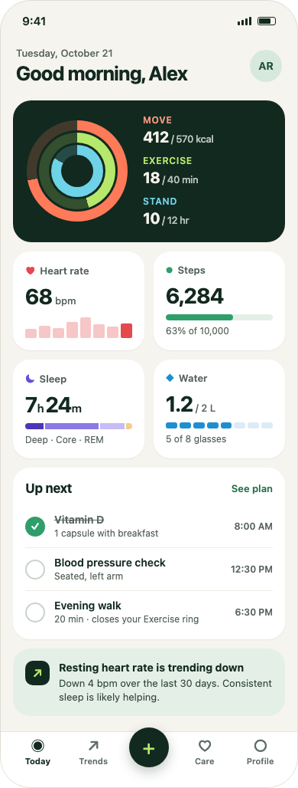
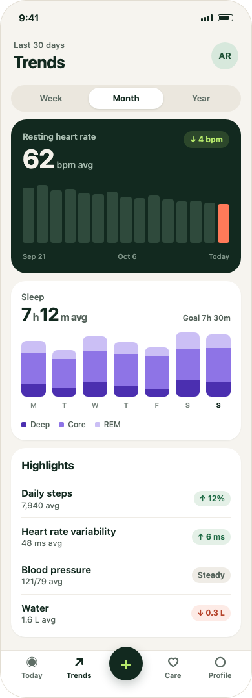
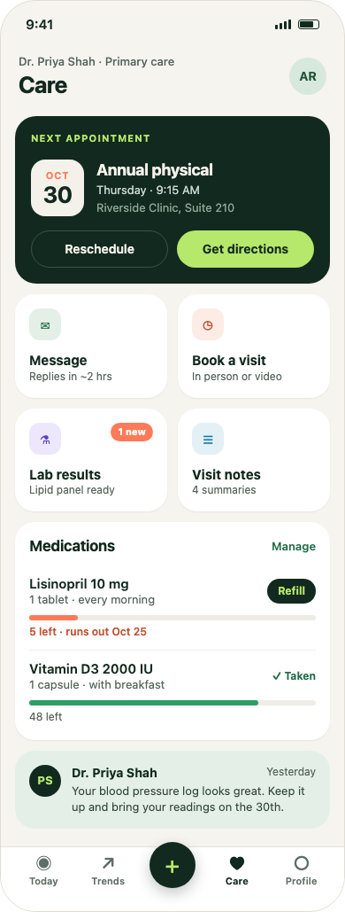
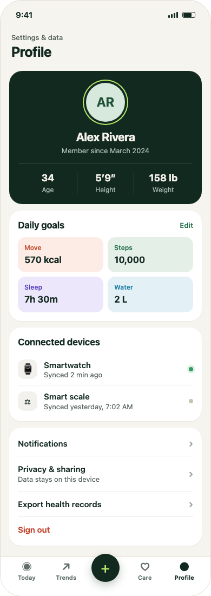

# build-from-reference (unplanned) — Claude Opus 5.5 — 2026-10-20

- **Eval:** build-from-reference, but **no reference image reached the agent**. It extended the existing Health app instead: three new mobile screens styled after `Health — Today (Mobile)`. Treat this as a baseline for process, not for fidelity.
- **Reference:** none. Opus compared against the existing Today screen.
- **Model and client:** Claude Opus 5.5 (client not recorded)
- **Weft version:** `4c380da` (design skill + `get_screenshot`, before the fixes this run led to)
- **Artboards:** `f_NX6nVbR0KQ` Health — Trends (Mobile), `f_jKxaCrLBbj` Health — Care (Mobile), `f_TiFpsES0ap` Health — Profile (Mobile). The prompt asked for one artboard named `Eval — …`, so naming didn't follow the prompt.
- **Wall time:** not recorded

## Usage (from the client, not the agent)

| Input tokens | Output tokens | Cache read | Cache write | Cost |
|---|---|---|---|---|
| not recorded | not recorded | not recorded | not recorded | not recorded |

The agent reported "not available", as the prompt asks when it can't see usage.

## Process (from the agent's report, checked against the canvas)

| Total calls | Rejected | Screenshots | Rebuilds | Read skill first |
|---|---|---|---|---|
| 27 (23 Weft) | 1 | 5 | 0 (one planned delete of copied content) | Yes, `SKILL.md` only |

Calls per tool: get_canvas ×5, get_screenshot ×5, create_nodes ×4, duplicate_node ×3, update_nodes ×2, delete_nodes ×1, list_tokens ×1, read_skill ×1, select_nodes ×1, plus client-side ToolSearch ×3 and Bash ×1 (jq to cut down a 75 KB `get_canvas` result).

Rejections and what the agent changed:
- `create_nodes`: `Tag <dl> is not valid for a frame node`. It switched to `div` and resent.

## Scores (1–5 each)

The "Reviewer" column is Claude's score from `get_screenshot` renders at 390 and 768. Fill in "Yours" with your own score.

| Criterion | Agent | Reviewer | Yours | Reviewer notes |
|---|---|---|---|---|
| Layout and proportions | 4 | 4 | | Matches Today's card system. Tiles and charts are well proportioned. |
| Typography | 4 | 4 | | Consistent scale reused from Today. Big numbers with small units read well. |
| Color and contrast | 4 | 4 | | Cohesive palette, and each metric has its own tint. "Week"/"Year" on the switcher look low-contrast. |
| Spacing and alignment | 4 | 4 | | Even 12px rhythm. The "1 new" badge sits awkwardly in the Lab results tile. |
| Other widths | 4 | 3 | | Fine at 390, the design width. At 768 it just stretches (no max width), and the agent never checked another width. |
| Semantics and token use | 3 | 3 | | Good tags and aria labels. Raw hex/px throughout, because it couldn't add palette tokens. |
| **Total /30** | **23** | **22** | | |

No reference image, so these score quality and consistency with the Today screen, not fidelity.

## Screenshots

Rendered with `get_screenshot` after the run:

| Today (existing) | Trends | Care | Profile |
|---|---|---|---|
|  |  |  |  |

Trends at 768: [trends-768.png](2026-10-20-health-screens-opus/trends-768.png)

## What Weft should fix

Fixed in the follow-up change (branch `agent-eval-fixes`):
- `duplicate_node` now returns `ids`, a map from every original node to its copy. That saves the 3 `get_canvas` calls Opus needed to find ids in the copies.
- `get_canvas` takes `detail: "outline"`: 68 KB → 8.6 KB on the Today screen, so there's no need for jq.
- `dl`/`dt`/`dd` and the table tags are allowed.
- `SKILL.md` lists the five most important rules and insists on reading `layout.md` and `style.md` before building.
- The skill asks for a check at the other end of the width range.

Still open:
- No way to add palette tokens over MCP, so custom palettes end up hard-coded (a `set_tokens` tool).
- No components, so the status bar and tab bar exist as four separate copies (roadmap: components and variants).
- No icons (the agent used Unicode symbols); this belongs with image support.

Next run: attach the reference image, and record usage from the client (`/cost` in Claude Code).
